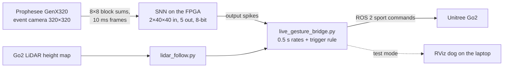

# Gesture control for the Unitree Go2 with a spiking network on the Kria KV260

Show the robot dog a gesture and it reacts. An event camera watches the person, a spiking neural
network (SNN) on the Kria KV260 FPGA recognises the gesture in a fraction of a millisecond, and a
ROS 2 bridge turns the result into a Go2 command.

| gesture | Go2 action |
|---|---|
| Heart (arms make a heart over the head) | finger heart |
| Turn left 360 (left arm out to the side and back) | closed-loop 360° turn to the left |
| Turn right 360 (right arm out to the side and back) | closed-loop 360° turn to the right |
| Follow me (walk on the spot) | LiDAR person following: walks after you, stops when you stop |
| anything else | nothing |

## Architecture



- **Input:** every 10 ms the camera's events are counted per 8×8 pixel block, separately for ON
  and OFF polarity, giving 2×40×40 frames. The board's `inputs.scaling = 64` turns the block sums
  into the block means the network was trained on.
- **Network (nb40):** 5 spiking convolution layers with 8-bit weights, trained with
  quantization-aware training on the exact integer format the firmware reads.
- **Decision:** the bridge counts each output's spikes over a 0.5 s window. A gesture triggers
  when its rate is high enough, beats the other gestures and the "none" output, and stays stable.
  Turns run in closed loop on the robot's IMU yaw. Real-robot tricks only start when the
  obstacle detection reports the area as clear.

## Results (FPGA, people never seen in training)

| accuracy | robot rule: correct / wrong / missed | false triggers on no-action | latency (median) |
|---|---|---|---|
| **99.2 %** | 98.3 % / 0 % / 1.7 % | 1.4 % | 0.15 ms per frame |

Measured by replaying recorded clips into the board (`training/optimised_snn/fpga_eval.py`).
A spike penalty in training cut the synaptic operations 30× (59k instead of 1.75M per step),
which brought the FPGA latency from 0.74 ms to 0.15 ms per frame at the same accuracy.

## Repository

| folder | contents |
|---|---|
| [`kria/`](kria/) | board software: `live_gesture_bridge.py` (FPGA → Go2), `bridge_settings.py`, `lidar_follow.py`, `inference.sh` (start/stop), `robot_link.sh`, `laptop_link.sh`, live viewers, `board_config/` |
| [`ros2/`](ros2/) | laptop side: ROS 2 environment (`env.sh`, `env_board_link.sh`), RViz Go2 model and animator, simulator |
| [`training/optimised_snn/`](training/optimised_snn/) | training (`train_snn_v8.py`), integer FPGA simulator (`spleat_sim.py`), FPGA tests (`fpga_eval.py`), dataset tools (`dataset/`) |
| [`models/optimised_snn/`](models/optimised_snn/) | trained weights in board format with their metrics |
| [`dashboard/`](dashboard/) | web dashboard to run the board, the robot, recording and training from a browser |
| [`doc/`](doc/) | [gesture pipeline](doc/gesture-pipeline.md): setup, running, decision rules, gotchas |

## Quick start

On the board (Kria, `ssh root@192.168.77.1`):

```bash
/root/inference.sh start              # test mode: camera → FPGA SNN → RViz dog (no robot)
/root/inference.sh robot --dry-run    # robot mode, decisions only logged
/root/inference.sh robot              # live: gestures move the Go2
/root/inference.sh stop
```

On the laptop, to watch the RViz dog in test mode:

```bash
source ros2/env_board_link.sh
ros2 launch ros2/rviz/view_go2.launch.py
```

Train a new 40×40 model (GPU, `riverops` installed):

```bash
cd training/optimised_snn
python train_snn_v8.py --zip go2_gestures_s20-33.zip --arch nb40 --val 28 --test 22,29,30,33 \
  --class-names "Heart,Turn left,Turn right,Follow me,No action" --mirror 1:2 --qat-bits 8h \
  --epochs 5 --qat-epochs 30 --qat-lr-scale 1.0 --spike-reg 3 --quiet-prob 0.15 --quiet-events 12
```

Details: [doc/gesture-pipeline.md](doc/gesture-pipeline.md),
[training/optimised_snn/README.md](training/optimised_snn/README.md),
[dashboard/README.md](dashboard/README.md).

## Author

Bhanuteja Vadlamudi ([github.com/tejavadlamudi03](https://github.com/tejavadlamudi03))

Built for the Durance AI track of the Berlin Robotics Hackathon 2026. MIT License.
